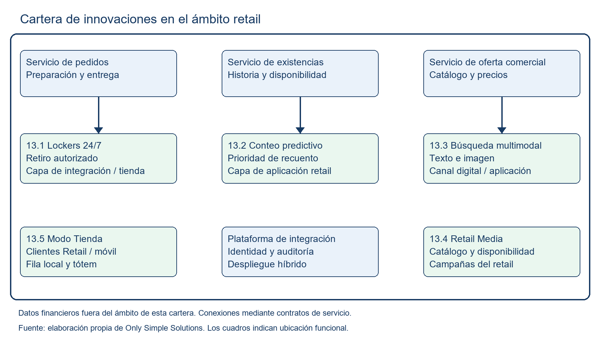

# Capítulo 13 · Introducción a las Innovaciones

Only Simple Solutions propone cinco innovaciones para Multitiendas Ancoa S.A., una por cada tipo del artículo 28 de las Bases Administrativas. La cartera comprende retiro autónomo mediante lockers, conteo cíclico predictivo, búsqueda vectorial multimodal, una red de publicidad para proveedores del retail y un modo tienda con fila virtual de probadores. Cada propuesta agrega una capacidad al alcance base y se verifica mediante resultados operativos propios. El conteo sin cierre de tienda, la tolerancia a errores del buscador y la separación de datos retail y financieros forman parte de las obligaciones de la solución; su cumplimiento no se contabiliza como innovación (Multitiendas Ancoa S.A., 2026a, arts. 28–30; 2026c, cap. 26).

Las secciones siguientes desarrollan los siete elementos exigidos por el artículo 29. Su incorporación se vincula con los servicios del subdocumento 3, con las capas de aplicación, integración y despliegue híbrido del subdocumento 4, con la gestión de datos del subdocumento 5 y con la rama 1.10 de la EDT del subdocumento 7. El Formulario T-19 reúne las fichas de aceptación y su trazabilidad. El capítulo 8 consolida los riesgos, y los subdocumentos 10 y 11 incorporan el soporte y la mantención. La valorización monetaria pertenece a la Oferta Económica; este capítulo describe inversión, costos operacionales y mecanismos de beneficio sin revelar el monto de la oferta.

La Figura 13.1 muestra la ubicación funcional de la cartera dentro del ámbito retail. Los conectores representan dependencias de aplicación, no accesos directos a bases de datos.

El servicio de existencias entrega la información que utiliza la priorización de conteos y la disponibilidad que consultan los canales. El servicio de pedidos confirma la preparación de los bultos antes de habilitar su retiro. El servicio de oferta comercial aporta catálogo y precios a búsqueda y publicidad. El modo tienda gestiona turnos desde el móvil y desde el tótem mediante el componente local de la tienda. Ninguna de estas capacidades utiliza saldos, mora, puntajes ni comportamiento de pago de la filial emisora.

El conteo predictivo se evalúa durante la marcha blanca de la Etapa 1 y entra en uso desde el mes 16, con lo que su beneficio puede verificarse antes de producción, conforme a RT-26.08. Las capacidades que dependen de pedidos y de los canales de relación con el cliente se incorporan en la Etapa 2 y se habilitan desde el mes 21. La preparación de hardware y el levantamiento de datos comienzan antes de esas fechas. El calendario mantiene el contrato de 56 meses y la operación entre los meses 21 y 56 (Multitiendas Ancoa S.A., 2026a, art. 17).

Para medir los resultados que el Caso no cuantifica, el proyecto levanta una línea base antes del piloto y conserva el protocolo de comparación. Las metas de mejora que dependen de ese levantamiento se fijan en el acta de diseño y se trasladan al T-19 antes de la prueba. Las cinco fichas distinguen esas mediciones de las cifras ya documentadas del Caso; tampoco transfieren a Ancoa porcentajes de desempeño publicados por fabricantes.
