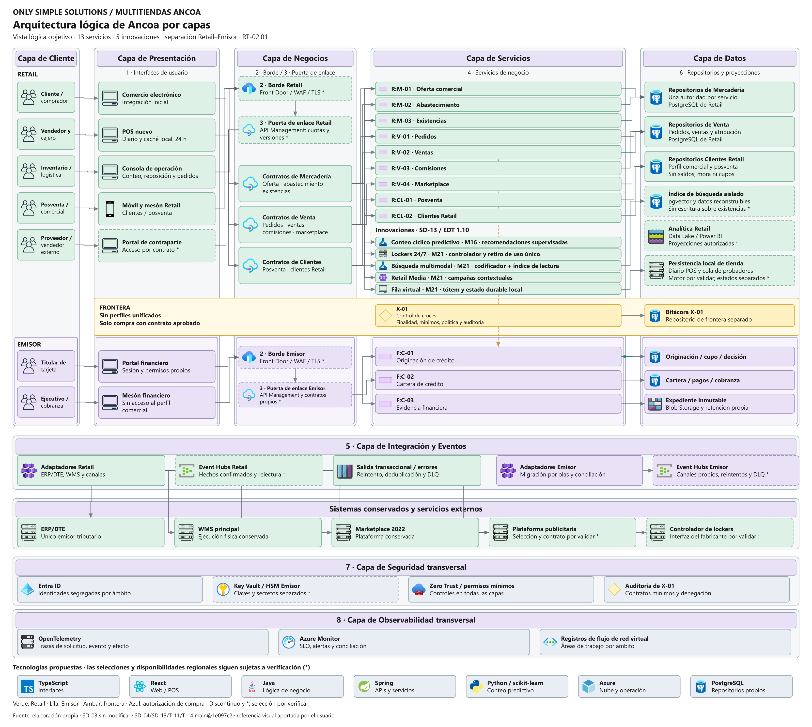

# Arquitectura por capas según la referencia del usuario

El usuario rechazó las figuras 4.21 y 4.22 como respuesta a su pedido y aportó una imagen con cinco columnas e iconos. Esta entrega conserva esa composición y sustituye los componentes clínicos del ejemplo por los de Ancoa. La referencia se usa para la forma, sin trasladar pacientes, módulos médicos, Node.js, Express ni plataformas del caso ajeno.

[Draw.io editable por objetos](../../../04_Adjuntos/diagramas/diag-04-23_arquitectura-logica-por-capas.drawio) · [SVG autocontenido](../../../04_Adjuntos/diagramas/diag-04-23_arquitectura-logica-por-capas.svg) · [JSON de componentes y contratos](../../../04_Adjuntos/diagramas/diag-04-23_arquitectura-logica-por-capas.json) · [Leyenda](../../../04_Adjuntos/diagramas/diag-04-23_arquitectura-logica-por-capas.leyenda.txt).

La Figura 4.23 mantiene Cliente, Presentación, Negocios, Servicios y Datos. Cliente agrupa actores. Presentación contiene interfaces sin acceso directo a datos. Negocios muestra Borde y Puerta de enlace y los grupos de contratos que publica el gateway, sin convertirlos en servicios funcionales nuevos. Servicios contiene los nueve servicios Retail, los tres financieros y las cinco innovaciones. X-01 aparece en la frontera, con su bitácora separada.

Las ocho capas de RT-02.01 quedan identificadas por número y nombre. Presentación es la 1; Borde y Puerta de enlace son 2 y 3; Servicios es la 4; Integración y Eventos es la 5; Datos es la 6; Seguridad y Observabilidad son 7 y 8 y se aplican de forma transversal. Los actores y las tecnologías del pie no se cuentan como capas adicionales.

Los servicios conservan sus códigos y nombres de SD-03. Los repositorios agrupados por área representan autoridades separadas, no una base compartida entre servicios o entidades. La fila financiera mantiene interfaces, contratos, datos y eventos propios. El único enlace directo previsto entre Retail y Emisor es la autorización de compra, condicionada al contrato aprobado. La política de X-01 se aplica en ambos extremos; los cruces no autorizados permanecen cerrados.

Las innovaciones conservan los paquetes y tiempos aceptados. Conteo cíclico predictivo corresponde a M16; lockers, búsqueda multimodal, Retail Media y fila virtual corresponden a M21. El conteo recomienda y la persona responsable confirma. Se mantienen el índice de lectura aislado y la persistencia local de la fila. La ayuda de clasificación de merma permitida en SD-03 no se convierte en un modelo autónomo adicional.

Los bordes discontinuos y asteriscos señalan productos o interfaces cuya disponibilidad, selección o contrato deben comprobarse. Los iconos se conservan en esos casos para distinguir qué capacidad se evalúa. Java/Spring y TypeScript/React proceden de la selección de SD-04; Python/scikit-learn corresponde al conteo de SD-13. La imagen no confirma versiones, licencias o soporte. OpenTelemetry usa un símbolo genérico de instrumentación, no el logotipo de otro producto.

La recuperación del Emisor continúa condicionada y no se da por cerrada con DC-02. La vista es lógica y no dimensiona equipos ni enlaces. El retiro de plataformas antiguas sigue las olas de SD-03 y no se adelanta por dibujar el objetivo funcional.

## Generación y comprobación

Se adaptó L2 de la guía a la composición con iconos pedida expresamente por el usuario. La variante clásica se conserva. La especificación se validó y renderizó mediante el MCP local `diagramas-ancoa`; no se utilizó el servidor original de andrewmoshu. La entrega incluye PNG, SVG, draw.io, JSON y leyenda. El SVG y draw.io contienen los iconos, sin depender de URLs externas.

La revisión automática comprueba capas presentes, componentes con iconos y restricciones de cruce. La revisión visual corrigió rótulos superpuestos, diferenció la autorización de compra y evitó que los grupos de contratos parecieran una secuencia de procesos. La fuente draw.io conserva objetos editables y puede rerutear conectores al abrirse. El PNG y el SVG representan la composición visual comprobada.

Uso de IA **Alto** para especificación, adaptación del renderizador y diagramación. La aceptación humana de esta imagen sigue pendiente. No se modificó SD-03 ni se insertó la figura en el `.tex`; su futura incorporación debe registrarse en la declaración de IA del capítulo. Esta nota aplica la revisión editorial de RR-24.
