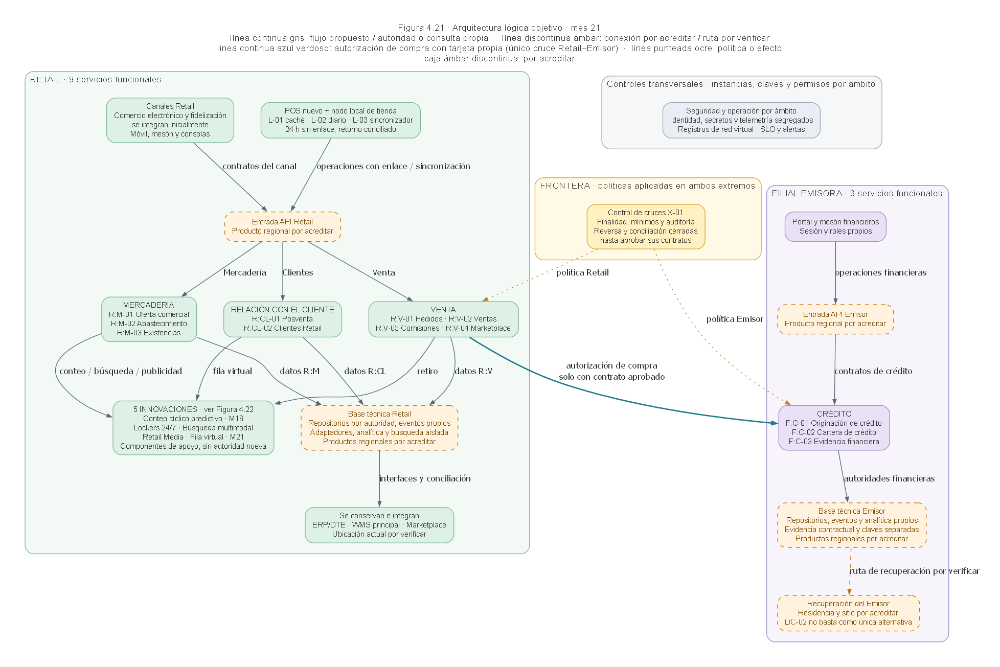
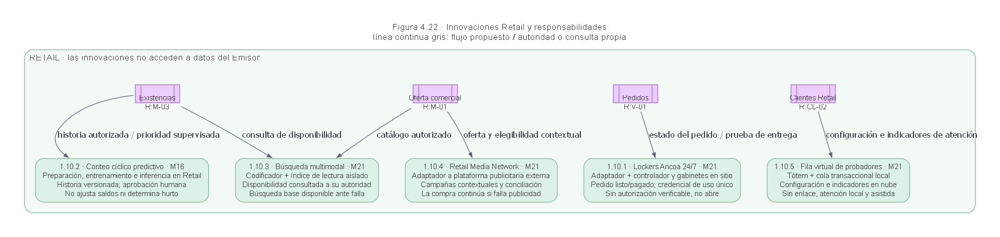

# Decisiones aceptadas y nueva arquitectura

**Corrección posterior del usuario.** Las figuras 4.21 y 4.22 de esta nota no satisfacen su pedido de arquitectura por capas. Se conservan como antecedentes de las decisiones, pero la respuesta visual vigente es la [Figura 4.23 por capas e iconos](arquitectura_por_capas_referencia.md), construida con la referencia que aportó después.

Fecha local 2026-10-21. La instrucción del usuario acepta las recomendaciones del diagnóstico que no impliquen modificar SD-03 y pide generar una nueva arquitectura. Esta nota registra esa aceptación y su efecto en las figuras. No declara superadas pruebas de nube, de capacidad, jurídicas ni de aceptación operacional.

La base documental continúa en `main@1e097c2`, conservada en [fuentes.md](fuentes.md). La salida nueva se encuentra en el árbol de `work`. Los nombres, las autoridades y los trece servicios de SD-03 se conservan. Las cajas por área de la vista general agrupan responsabilidades; no afirman que cada área sea un ejecutable ni que comparta una base de datos.

## Decisiones y límites de la aceptación

La tabla distingue la decisión aceptada del trabajo técnico que aún debe completarse. Ninguna fila autoriza modificar SD-03.

| Hallazgo | Decisión registrada | Aplicación en esta entrega | Evidencia o trabajo pendiente |
|---|---|---|---|
| H01 | Integrar las cinco innovaciones como componentes de apoyo de Retail, manteniendo los 13 servicios funcionales. | Figura 4.21 y detalle 4.22 con paquetes 1.10.1–1.10.5 y M16/M21. | Integración posterior en el cuerpo de SD-04 y sus tablas, sin alterar SD-03. |
| H02 | Reformular la clasificación de merma como ayuda basada en evidencia y confirmación humana. No añadir un modelo predictivo independiente de clasificación de causas o hurto. | El componente de IA explícito es el priorizador de conteos, que no ajusta saldos ni determina hurto. | Conservar la ayuda que SD-03, 3.3.2, permite para sugerir causas. La persona responsable confirma la causa. No retirar el registro, desglose ni informe de merma obligatorio. |
| H03 | Mantener la integración inicial de comercio electrónico y fidelización. La contradicción sobre su eventual sustitución queda fuera de esta aceptación. | Los canales conservan su integración inicial; no se dibuja un reemplazo. | Resolver el alcance de sustitución requeriría conciliar SD-03 y por eso permanece pendiente. |
| H04 | Exigir una recuperación del Emisor que cumpla independencia de amenazas y RTO/RPO; DC-02 no cierra por sí solo esa exigencia. | Recuperación marcada por acreditar, sin inventar un proveedor o sitio nacional. | Evaluar alternativa nacional si no se aprueba Brasil. Selección de sitio, residencia y pruebas siguen pendientes. |
| H05 | Conservar las capacidades y condicionar los productos a disponibilidad regional y pruebas. | Entrada API y base técnica de cada ámbito marcadas por acreditar. | Verificar región, SKU, zonas, cuotas y replicación. El dibujo no confirma que un producto esté disponible. |
| H06 | Mantener el catálogo funcional y separar servicio, ejecutable, repositorio, clúster y réplica. | 9 servicios Retail, 3 financieros y X-01. No se reproduce el total no demostrado de 13–14 ejecutables. | Completar el mapa de despliegues y el alojamiento de módulos antes de recalcular nodos. |
| H07 | Usar una sola volumetría vigente, derivada de SD-05, para SD-04 y T-11. | El diagrama lógico no fija capacidad a partir de memorias contradictorias. | Conciliar fórmulas y horizonte de las memorias; conservar la anterior como antecedente identificado. No se afirma que la conciliación ya se haya ejecutado. |
| H08 | Corregir la suma de discos y distinguir copias. | Se registra 2,625 TiB por copia y 5,25 TiB para primarios más espera, sin DR ni respaldos. | Trasladar la corrección a SD-04/T-11 al editar esas fuentes. La figura no mezcla cantidades físicas con componentes lógicos. |
| H09 | Evaluar crecimiento y falla con términos fijos/variables y con las cargas de innovaciones. | Se exige aislamiento de las cargas; no se conservan como definitivos máximos de nodos no demostrados. | Recalcular y ensayar crecimiento, ráfagas y pérdida de zona antes de fijar máximos. |
| H10 | Especificar registros de flujo de red virtual para el horizonte futuro, manteniendo NSG como control. | Figura 4.21, bloque de seguridad y operación por ámbito. | Verificar configuración, almacenamiento, retención e integración. |
| H11 | Usar T-11 como detalle de suministro para esta arquitectura y evitar una remisión nueva a un Excel no localizado. | Esta nota remite a T-11 y no presenta un adjunto inexistente. | Corregir la remisión antigua de SD-04 cuando se edite su texto. |
| H12 | Mantener la política de denegación y documentar los contratos; no abrir cruces financieros nuevos. | Solo aparece la autorización de compra, condicionada a contrato aprobado. Reversa y conciliación siguen cerradas hasta aprobación. | Completar fichas, campos, custodios, retención, caducidad y pruebas negativas sin modificar los compromisos de SD-03. |
| H13 | Aislar búsqueda, entrenamiento e innovación local de la ruta crítica de venta y del diario. | Índice de lectura aislado y componentes separados en 4.22. | Elegir y probar el aislamiento de recursos. Esta vista no impone que cada carga tenga una nueva instancia física. |

## Figura 4.21. Vista lógica general

La nueva arquitectura conserva los frentes Retail y Filial emisora y ubica X-01 entre ellos. Las áreas Retail reúnen los nueve servicios con sus nombres y códigos. Crédito reúne los tres financieros. Los repositorios, eventos, claves y permisos permanecen separados por ámbito. El bloque transversal representa controles que se aplican por ámbito, no un almacén compartido de identidades financieras y comerciales.

Fuente: elaboración propia a partir de SD-03, SD-13, T-11 y T-14 de `main@1e097c2`, con las decisiones aceptadas por el usuario el 21-10-2026. [Fuente editable JSON](../../../04_Adjuntos/diagramas/diag-04-21_arquitectura-logica-decisiones-aceptadas.json), [SVG](../../../04_Adjuntos/diagramas/diag-04-21_arquitectura-logica-decisiones-aceptadas.svg) y [leyenda](../../../04_Adjuntos/diagramas/diag-04-21_arquitectura-logica-decisiones-aceptadas.leyenda.txt).

Las flechas representan familias de interacción lógica; no son el inventario de las catorce interfaces actuales ni especifican todos los mensajes de un protocolo. Los enlaces entre servicios y base técnica resumen contratos y datos de cada responsabilidad. No conceden acceso directo a repositorios ajenos ni obligan a ejecutar todas las integraciones mediante eventos. La autorización de compra es una solicitud y su respuesta mínima, gobernadas por la política en ambos extremos. La ruta de recuperación del Emisor continúa pendiente de acreditación.

La fecha M21 identifica la vista objetivo funcional, no el apagado simultáneo de todas las plataformas antiguas. Las olas financieras y sus fechas siguen las condiciones de SD-03. Los adaptadores de convivencia continúan mientras sus olas no estén aceptadas, aunque la vista general no detalle esas conexiones temporales.

## Figura 4.22. Detalle de las innovaciones

El detalle vincula cada capacidad con el servicio responsable y explicita dónde la innovación entrega una recomendación, consulta una autoridad o conserva un estado local. Los paquetes y momentos de entrada provienen de la cartera y de T-14.

Fuente: elaboración propia a partir de las mismas fuentes de la Figura 4.21. [Fuente editable JSON](../../../04_Adjuntos/diagramas/diag-04-22_innovaciones-y-servicios-responsables.json), [SVG](../../../04_Adjuntos/diagramas/diag-04-22_innovaciones-y-servicios-responsables.svg) y [leyenda](../../../04_Adjuntos/diagramas/diag-04-22_innovaciones-y-servicios-responsables.leyenda.txt).

El priorizador consume historia de existencias y propone trabajo al responsable. La búsqueda combina catálogo con consulta de disponibilidad y conserva el buscador base como contingencia. Retail Media usa campañas contextuales y debe fallar sin bloquear la compra. El locker recibe el estado del pedido, valida una credencial de uso único y registra el retiro; no promete apertura desconectada si no puede verificar la autorización. La fila se conserva localmente durante el corte y sincroniza configuración e indicadores con la nube, manteniendo atención asistida.

Los enlaces condensan entradas y resultados y no delegan escritura sobre saldos. Los productos de referencia y los permisos de datos siguen sujetos a sus verificaciones. El comportamiento de desconexión de los lockers y de los móviles no se equipara al de la cola local del tótem.

## Verificación y uso de IA

Las especificaciones usan L1 y L3 del catálogo instalado. Se generaron mediante una sesión MCP stdio con `diagramas-ancoa`; ambas pasaron la validación con cero errores y cero avisos antes del renderizado. Se revisaron visualmente las imágenes y se separó el detalle de innovaciones para reducir la densidad de la vista general.

El nivel de uso de IA de estas figuras es **Alto**. La IA preparó especificaciones y textos y el MCP produjo PNG, SVG y leyenda. La incorporación futura al capítulo debe registrar ese uso en su Declaración de IA y en la Tabla 4.17 correspondiente. Los números 4.21 y 4.22 son los de estos adjuntos nuevos; no se insertaron ni renumeraron las figuras del `.tex`.

La aceptación de decisiones consta en el mensaje del usuario. La lectura visual y técnica del equipo sobre estas nuevas imágenes permanece pendiente. La redacción de esta nota aplica `humanizer` con el alcance de RR-24. No se asigna el estado `revisado` al subdocumento.
